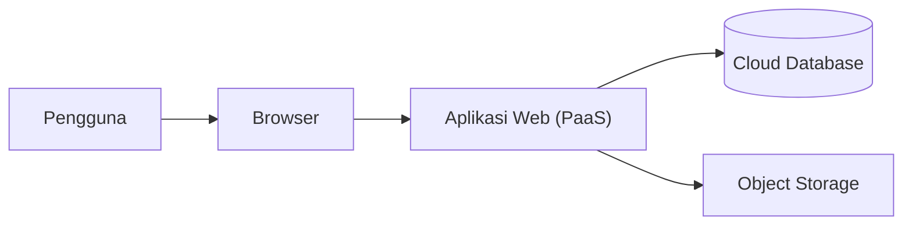

# Rancangan Sistem Informasi Akademik (E-Learning)

[Beranda](../README.md) · [Analisis](../01_analisis) · [Panduan](../03_panduan)

## 1. Arsitektur Sistem

Sistem Informasi Akademik berbasis E-Learning dirancang sebagai aplikasi web yang dapat diakses oleh administrator, dosen, dan mahasiswa melalui internet. Sistem memanfaatkan layanan cloud untuk menjalankan aplikasi serta menyimpan data dan berkas pembelajaran.

## 2. Modul dan Fitur Sistem

| Modul         | Fitur                                                                      | Pengguna            |
| ------------- | -------------------------------------------------------------------------- | ------------------- |
| Autentikasi   | Masuk dan keluar dari sistem.                                              | Semua pengguna      |
| Dashboard     | Menampilkan informasi sesuai peran pengguna.                               | Semua pengguna      |
| Administrasi  | Mengelola akun dan memantau aktivitas sistem.                              | Administrator       |
| Log Aktivitas | Melihat riwayat aktivitas pengguna dan sistem.                             | Administrator       |
| Kelas         | Dosen membuat dan mengelola kelas, mahasiswa bergabung melalui kode kelas. | Dosen dan Mahasiswa |
| Materi        | Dosen mengunggah materi, mahasiswa mengakses materi.                       | Dosen dan Mahasiswa |
| Tugas         | Dosen memberikan tugas, mahasiswa mengumpulkan jawaban.                    | Dosen dan Mahasiswa |
| Kuis          | Dosen membuat kuis, mahasiswa mengerjakan kuis.                            | Dosen dan Mahasiswa |
| Nilai         | Dosen memberikan nilai, mahasiswa melihat hasil penilaian.                 | Dosen dan Mahasiswa |
| Presensi      | Dosen mencatat kehadiran, mahasiswa melihat status kehadiran.              | Dosen dan Mahasiswa |
| Pengumuman    | Dosen membuat pengumuman, mahasiswa membaca pengumuman.                    | Dosen dan Mahasiswa |

## 3. Hak Akses Pengguna

| Pengguna      | Hak Akses                                                                                                                  |
| ------------- | -------------------------------------------------------------------------------------------------------------------------- |
| Administrator | Mengelola akun pengguna, memantau aktivitas sistem, dan melihat log aktivitas.                                             |
| Dosen         | Membuat dan mengelola kelas, materi, tugas, kuis, nilai, presensi, serta pengumuman.                                       |
| Mahasiswa     | Bergabung ke kelas, mengakses materi, mengumpulkan tugas, mengerjakan kuis, serta melihat nilai, presensi, dan pengumuman. |

## 4. Alur Proses Sistem

### 4.1 Autentikasi

1. Pengguna memasukkan email dan kata sandi.
2. Sistem memeriksa data pengguna.
3. Jika sesuai, pengguna diarahkan ke dashboard berdasarkan perannya.
4. Jika tidak sesuai, sistem menampilkan pesan kesalahan.

### 4.2 Pengelolaan Kelas

1. Dosen membuat kelas dan mengisi informasi kelas.
2. Sistem menghasilkan kode kelas yang dapat dibagikan kepada mahasiswa.
3. Mahasiswa memasukkan kode untuk bergabung ke kelas.
4. Dosen dapat mengelola anggota dan informasi kelas.
5. Mahasiswa dapat mengakses kelas yang telah diikuti.

### 4.3 Materi Pembelajaran

1. Dosen mengunggah materi perkuliahan.
2. Sistem menyimpan materi.
3. Mahasiswa dapat melihat dan mengunduh materi.

### 4.4 Pengumpulan Tugas dan Kuis

1. Dosen membuat tugas atau kuis.
2. Mahasiswa mengerjakan tugas atau kuis.
3. Mahasiswa mengumpulkan jawaban melalui sistem.
4. Dosen memeriksa dan memberikan nilai.
5. Mahasiswa dapat melihat hasil penilaian.

### 4.5 Presensi dan Pengumuman

1. Dosen mencatat kehadiran mahasiswa.
2. Mahasiswa dapat melihat informasi kehadirannya.
3. Dosen membuat pengumuman kelas.
4. Mahasiswa dapat membaca pengumuman tersebut.

### 4.6 Administrasi dan Pemantauan Sistem

1. Administrator mengelola akun dosen dan mahasiswa.
2. Administrator memantau aktivitas pengguna melalui log sistem.
3. Administrator dapat menonaktifkan akun jika diperlukan.
4. Sistem mencatat aktivitas penting untuk keperluan pemantauan.

## 5. Keamanan Sistem

- Setiap pengguna memiliki akun dan kata sandi.
- Hak akses dibatasi berdasarkan peran pengguna.
- Dosen hanya dapat mengelola kelas yang dimilikinya.
- Mahasiswa hanya dapat mengakses kelas yang diikuti.
- Sistem mencatat aktivitas penting pengguna.
- Data pengguna dan pembelajaran disimpan dengan aman.
- Sistem menyediakan pencadangan data untuk mengurangi risiko kehilangan informasi.
